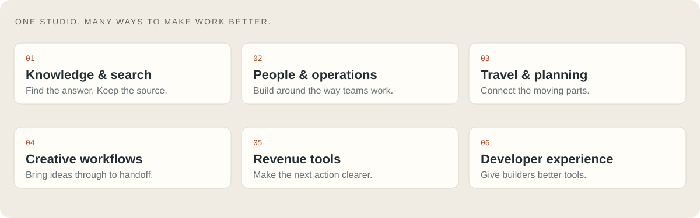
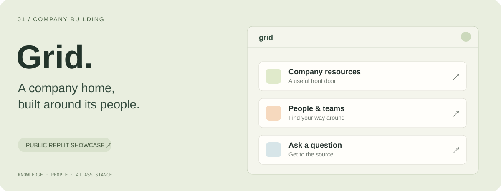
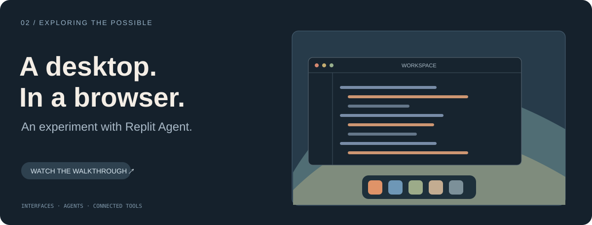
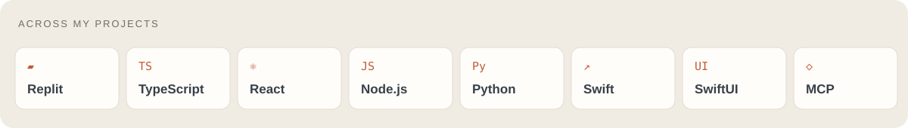
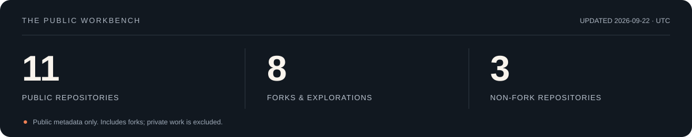

  <picture><source media="(max-width: 600px)" srcset="assets/hero-mobile.svg"></picture>

  
  
  

  <a href="#what-i-build">What I build</a> &nbsp; / &nbsp;
  <a href="#selected-work">Selected work</a> &nbsp; / &nbsp;
  <a href="#how-i-work">How I work</a> &nbsp; / &nbsp;
  <a href="#the-workbench">The workbench</a>

### Ciao, I'm Luca.

I'm the **AI Chief of Staff at [Replit](https://replit.com)**, based in San Francisco. I lead AI Studio, where I work with teams to turn the way they actually work into software built around them.

My work runs from the first conversation about a problem to the product, the rollout, and the people using it. I build with AI, care deeply about the interface, and stay involved after the demo.

**The question I keep coming back to: what would we build if we didn't have to accept the tools we inherited?**

## What I build

<picture><source media="(max-width: 600px)" srcset="assets/work-map-mobile.svg"></picture>

Company knowledge that is easier to find. Internal tools that fit the team. Creative and operational workflows that connect. Alongside that work, I explore native apps, personal knowledge systems, automotive software, and new ways to work with agents.

## Selected work

**Grid · Internal tools, built for the team.** An employee hub bringing documents, an org chart, and AI-assisted answers into one place. Publicly showcased by Replit. [See the story ↗](https://www.linkedin.com/posts/luca-andrea_one-of-many-examples-of-whats-possible-when-activity-7468756111131582464-Y8Uq)

<b>Inside the idea: make company knowledge usable</b>

The starting point was information spread across Google Drives. The opportunity was to give employees a useful front door: shared resources, a view of the organization, and an assistant that could help answer everyday questions.

It's the kind of work I love: start with a real friction point, build around the people experiencing it, and connect the pieces into something they can use.

 

**A desktop in the browser · A test of what's possible.** A macOS-inspired web environment with developer tools, connected services, and an AI assistant that interacts with the environment. Built with Replit Agent and shared as a public demo. [Watch the walkthrough ↗](https://www.linkedin.com/posts/luca-andrea_there-is-an-ongoing-debate-in-the-tech-community-activity-7434776130030600193-CMk7)

<b>Inside the experiment: beyond a single screen</b>

I wanted to explore how far natural-language software development could go. The demo brings together a desktop, a code editor, a terminal, GitHub connectivity, and voice or text interactions in one browser-based environment.

This is an independent experiment inspired by macOS, not an Apple product. The public walkthrough shows the work; the artwork above is an illustration.

## How I work

| Listen | Build | Learn | Enable |
| :--- | :--- | :--- | :--- |
| Understand the team, the friction, and the data. | Turn the problem into something people can try. | Use real feedback to improve the workflow. | Teach it, hand it off, and keep it useful. |

<b>A little more about the way I build</b>

- **Start with the workflow.** Spend time with the people who do the work.
- **Make the idea tangible.** A working prototype makes a better conversation.
- **Treat design as part of the product.** Clarity, speed, and the small details matter.
- **Finish the handoff.** Documentation, teaching, ownership, and maintenance belong in the plan.
- **Keep the evidence honest.** A working demo, a released product, and real adoption are different milestones.

## The workbench

<picture><source media="(max-width: 600px)" srcset="assets/toolkit-mobile.svg"></picture>

My public repositories are a mix of experiments, adaptations, and forks. Much of my day-to-day company work is private. A few corners to explore:

| Explore | Why it's here |
| :--- | :--- |
| [GT7 simdash](https://github.com/lucaandrea/gt7-simdash) | My working copy of a community Gran Turismo telemetry dashboard. Upstream credit: [chrshdl/gt7-simdash](https://github.com/chrshdl/gt7-simdash). |
| [PhoneAgent](https://github.com/lucaandrea/PhoneAgent) | Exploring agents on personal devices. A fork of [rounak/PhoneAgent](https://github.com/rounak/PhoneAgent). |
| [Open Deep Research](https://github.com/lucaandrea/open-deep-research) | Exploring research agents and retrieval. A fork of [nickscamara/open-deep-research](https://github.com/nickscamara/open-deep-research). |

Public GitHub snapshot. Daily refresh is enabled only when this repository is public. Counts include forks and exclude private repositories; they do not measure product adoption.

---

  <a href="https://www.linkedin.com/in/luca-andrea/">Connect on LinkedIn ↗</a> &nbsp; · &nbsp;
  <a href="https://x.com/agi2asi">Follow the experiments ↗</a> &nbsp; · &nbsp;
  <a href="https://github.com/lucaandrea?tab=repositories">Explore the code ↗</a>

