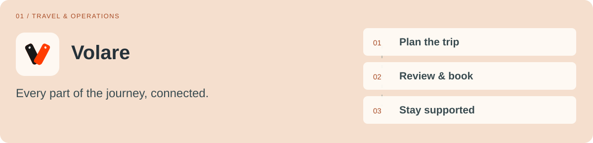
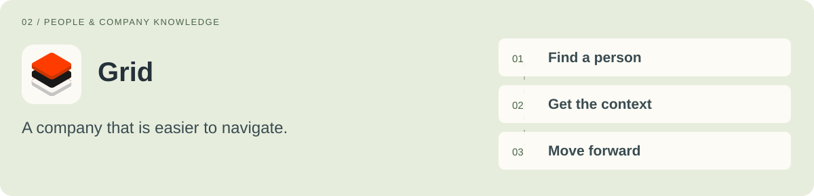
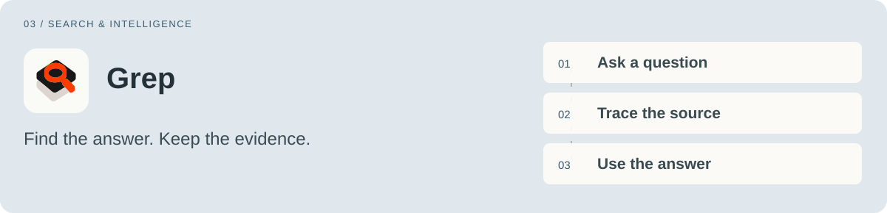
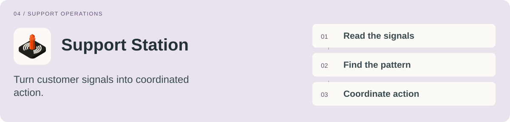
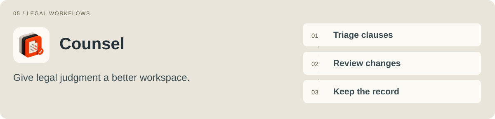
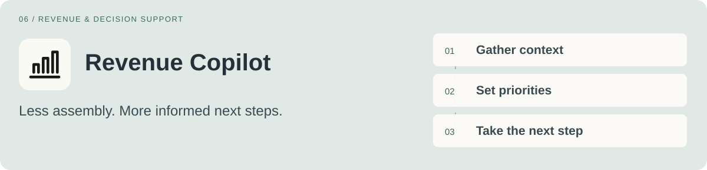
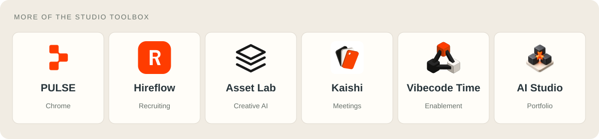
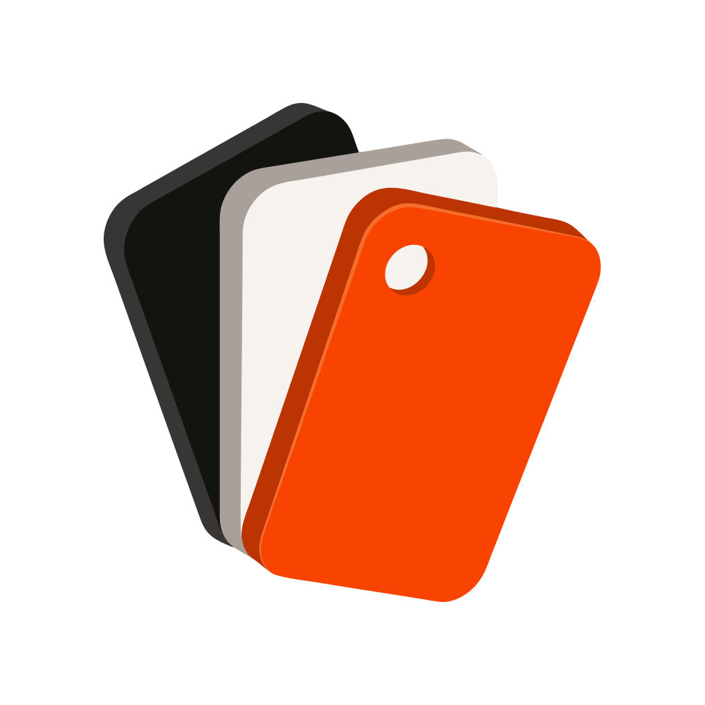
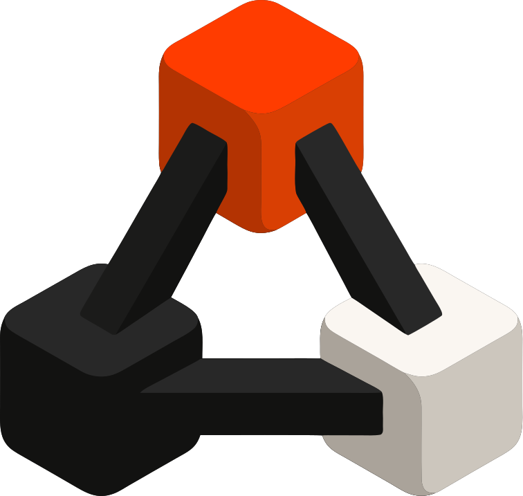
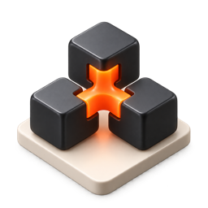

<picture><source media="(max-width: 600px)" srcset="assets/hero-mobile.svg"></picture>

  
  
  
  
  

<a href="#why-internal-tools">Why internal tools</a> &nbsp; / &nbsp; <a href="#inside-ai-studio">Inside AI Studio</a> &nbsp; / &nbsp; <a href="#more-of-the-studio">The toolbox</a> &nbsp; / &nbsp; <a href="#how-i-work">How I work</a>

### Ciao, I'm Luca.

I'm the **AI Chief of Staff at [Replit](https://replit.com)**, based in San Francisco. I lead AI Studio, where I work with teams to turn operational problems into products built around the way they actually work.

**Operator by instinct. Builder by practice. People first. Then the software.**

## Why internal tools

I build internal tools because the gaps between systems become work for people: finding an answer, coordinating a trip, reviewing a contract, assembling account context. I connect that context and design the next step into the product, from the first conversation through the rollout, teaching, and continued improvement.

The question I start with: **where does the work get stuck?**

## Inside AI Studio

My work spans travel, company knowledge, support, legal, revenue, and the tools that help teams build. Each product starts with a particular workflow and the people responsible for it.

### Volare

<picture><source media="(max-width: 600px)" srcset="assets/volare-mobile-card.svg"></picture>

A corporate travel platform connecting trips, flights, hotels, policy, approvals, and spend across web and native iOS.

**Why:** Travelers need a clear next step. Operations and finance need the same picture, especially when plans change.

  

<b>Volare — why I build it</b>

I bring the traveler experience and the operational work behind it into one product: trip planning, group travel, exceptions, and the context needed to support people along the way.

**The workflow:** Plan the trip → Review & book → Stay supported.

### Grid

<picture><source media="(max-width: 600px)" srcset="assets/grid-mobile-card.svg"></picture>

An employee home for company resources, people, teams, org structure, office information, and everyday answers.

**Why:** Finding the right person or document should not depend on knowing which channel to ask in.

  

<b>Grid — why I build it</b>

Grid gives scattered company information a useful front door. People, resources, and places belong together because that is how employees experience the company.

**The workflow:** Find a person → Get the context → Move forward.

### Grep

<picture><source media="(max-width: 600px)" srcset="assets/grep-mobile-card.svg"></picture>

A company search and intelligence workspace for finding decisions, prior work, source material, and the people behind them.

**Why:** Useful answers need traceable sources and the right access, not another layer of information to sort through.

  

<b>Grep — why I build it</b>

Grep brings retrieval, synthesis, and company context into a workspace built around questions people actually ask. The source remains part of the answer, so the next decision has something solid behind it.

**The workflow:** Ask a question → Trace the source → Use the answer.

### Support Station

<picture><source media="(max-width: 600px)" srcset="assets/support-mobile-card.svg"></picture>

A support workspace connecting queue health, customer sentiment, quality, reporting, knowledge gaps, and incident response.

**Why:** Support teams need to see what needs attention and connect individual issues to patterns across the product.

  

<b>Support Station — why I build it</b>

Support Station brings operational context and AI-assisted analysis into the same place. The aim is to help engineers, managers, and leaders understand the situation, investigate recurring issues, and coordinate the response.

**The workflow:** Read the signals → Find the pattern → Coordinate action.

### Counsel

<picture><source media="(max-width: 600px)" srcset="assets/counsel-mobile-card.svg"></picture>

AI-assisted contract review bringing clause triage, playbooks, redlines, precedent, and negotiation context into one workspace.

**Why:** Legal teams need the relevant evidence beside the clause they are reviewing, with control over every decision.

  

<b>Counsel — why I build it</b>

Counsel organizes the work around the contract: compare a clause with the playbook, review a proposed change, and retain the reasoning and history. AI helps prepare and surface context; the lawyer stays in charge of review.

**The workflow:** Triage clauses → Review changes → Keep the record.

### Revenue Copilot

<picture><source media="(max-width: 600px)" srcset="assets/revenue-mobile-card.svg"></picture>

A shared workspace for revenue priorities, pipeline, forecasts, account research, and AI-assisted daily work.

**Why:** Teams should be able to act on account context without rebuilding it from disconnected systems every morning.

  

<b>Revenue Copilot — why I build it</b>

Revenue Copilot brings work queues, research, analytics, and team visibility together. Numbers and recommendations retain their source context, so the team can understand what it is acting on.

**The workflow:** Gather context → Set priorities → Take the next step.

## More of the Studio

<picture><source media="(max-width: 600px)" srcset="assets/toolbox-mobile.svg"></picture>

<b>PULSE</b> · Builder tools & extensions

Chrome and Raycast companions for app building, project access, and permission-aware project insights.

**Why:** Bring useful context into the tools people already use, so getting to the work takes fewer steps.

PULSE connects desktop and browser workflows with Replit. The surrounding release hub gives employees a clear place to get the companions and understand what changed.

<b>Hireflow</b> · Recruiting workflows

A hiring workspace connecting sourcing, candidate search, screening evidence, recruiter calibration, and ATS workflows.

**Why:** Recruiters need consistent context and a clear way to inspect the evidence behind a recommendation.

Hireflow brings the steps around a role into a shared workflow, from discovering candidates to reviewing their supporting material. Recruiter judgment and calibration are part of the product.

<b>Asset Lab</b> · Creative & brand operations

An AI-powered brand and asset workspace for generating, organizing, and working with launch and marketing material.

**Why:** Creative work needs a path from an idea to something the team can find, reuse, and put to work.

Asset Lab brings creation and asset management together. Brand context, generation, and organization sit within the same workflow instead of being scattered across separate tools.

<b>Kaishi</b> · Meetings & follow-through

Meeting capture, searchable transcripts, decisions, and actions brought into a dedicated workspace.

**Why:** A good conversation should leave context people can recover and a next step they can follow.

Kaishi began with the need to preserve the value of a standup. It connects what was said with the actions and project context that follow, and informed the development of the broader Studio workbench.

<b>Vibecode Time</b> · Company building culture

An internal platform for build challenges, themes, submissions, voting, and sharing what employees make with Replit Agent.

**Why:** People learn what AI can do by using it on a real idea and seeing what their colleagues create.

Vibecode Time gives company building events a home, from joining a challenge to submitting a project and discovering the work. Enablement becomes something people participate in.

<b>AI Studio</b> · The operating workbench

A portfolio workbench for requests, projects, meetings, feedback, tasks, and reviewed priorities across the Studio.

**Why:** As the portfolio grows, requests, ownership, evidence, and follow-through need to stay connected.

The workbench brings Studio coordination into one place while source applications keep their own records and access boundaries. It is being developed through a pilot, with rollout and team adoption treated as separate milestones.

Alongside these products, my work includes the **Design Gallery**: reusable Canvas examples that help more people design and build. The wider Studio portfolio also includes **Repforce**, a team-led CRM and revenue intelligence effort.

## How I work

| Listen | Build | Learn | Enable |
| :--- | :--- | :--- | :--- |
| Understand the people, the friction, and the information behind the work. | Turn one useful workflow into something the team can try. | Observe use, gather feedback, and improve the details. | Teach it, document it, establish ownership, and keep it useful. |

<b>The principles behind the products</b>

- **Start with the person.** Understand the work before choosing where AI belongs.
- **Give intelligence a clear job.** Find context, prepare a draft, or make the next action easier.
- **Keep sources and decisions visible.** People should understand what informed an answer and what needs their review.
- **Design the whole experience.** The interface, permissions, handoffs, and everyday details are part of the product.
- **Stay after the prototype.** Teaching, ownership, feedback, and maintenance make a tool useful over time.

       

## Beyond the profile

[**luca.ooo**](https://luca.ooo) — my portfolio and [field notes](https://luca.ooo/insights/ai-chief-of-staff) on operations, AI, and product design.

[**agi2asi.ai**](https://agi2asi.ai) — the curiosity behind the work, exploring what increasingly capable AI lets one person make.

<a href="mailto:ciao@luca.ooo">Say ciao ↗</a> &nbsp; · &nbsp; <a href="https://www.linkedin.com/in/luca-andrea/">LinkedIn ↗</a> &nbsp; · &nbsp; <a href="https://x.com/agi2asi">X / @agi2asi ↗</a>

