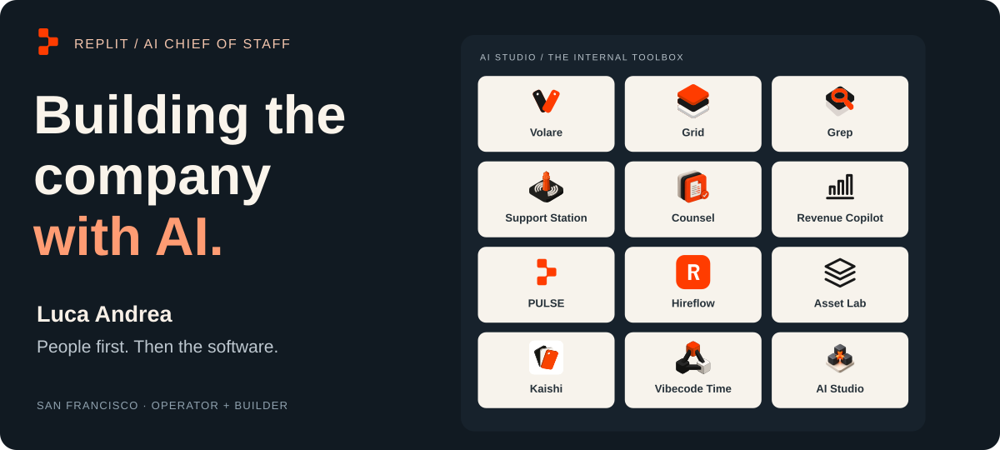
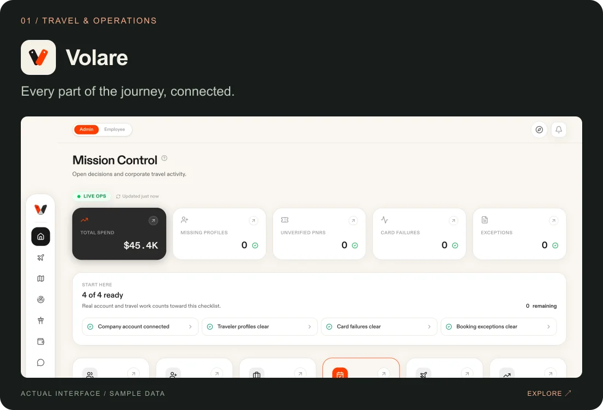
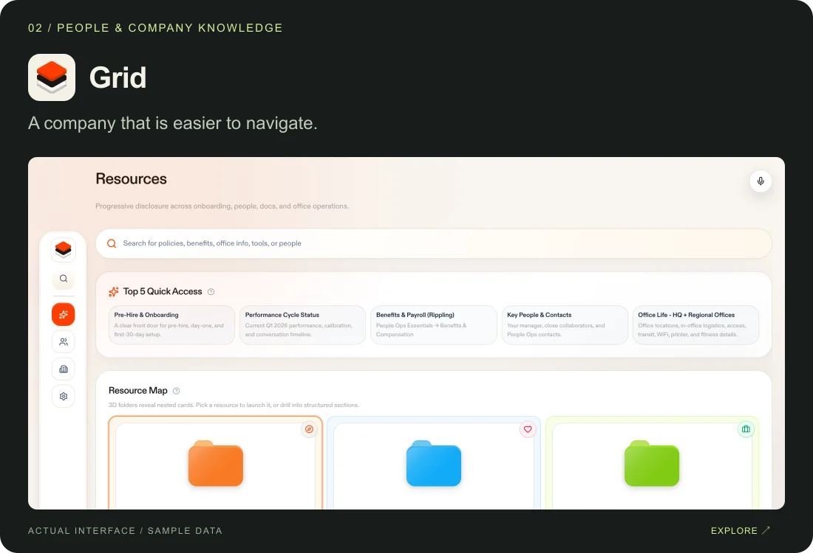
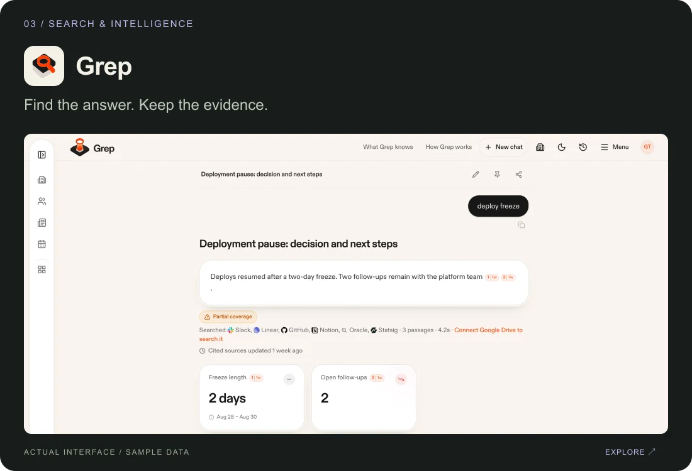
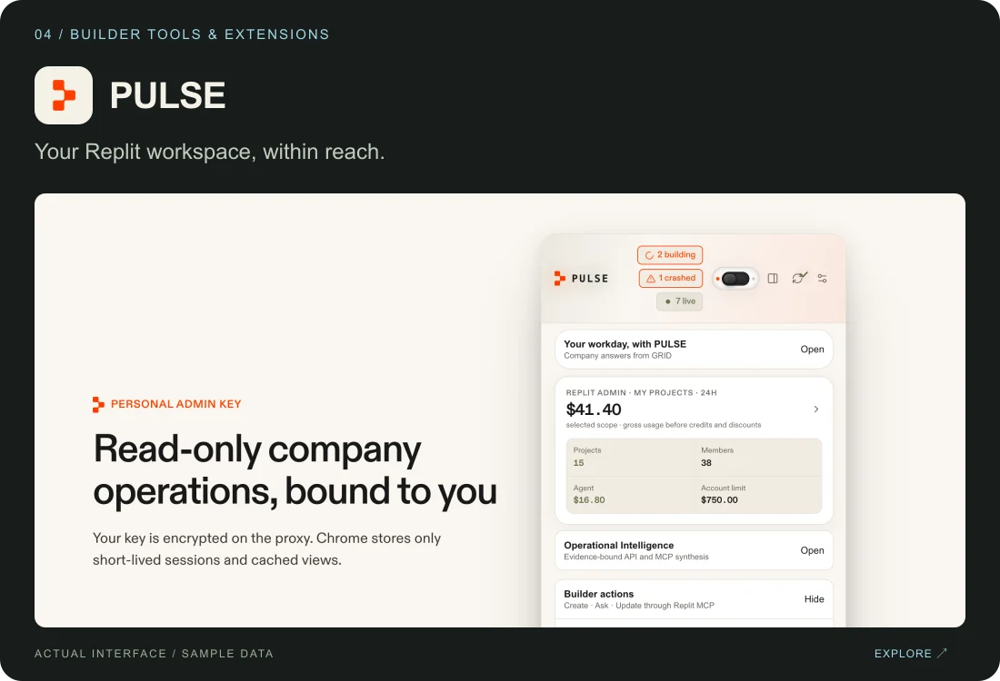
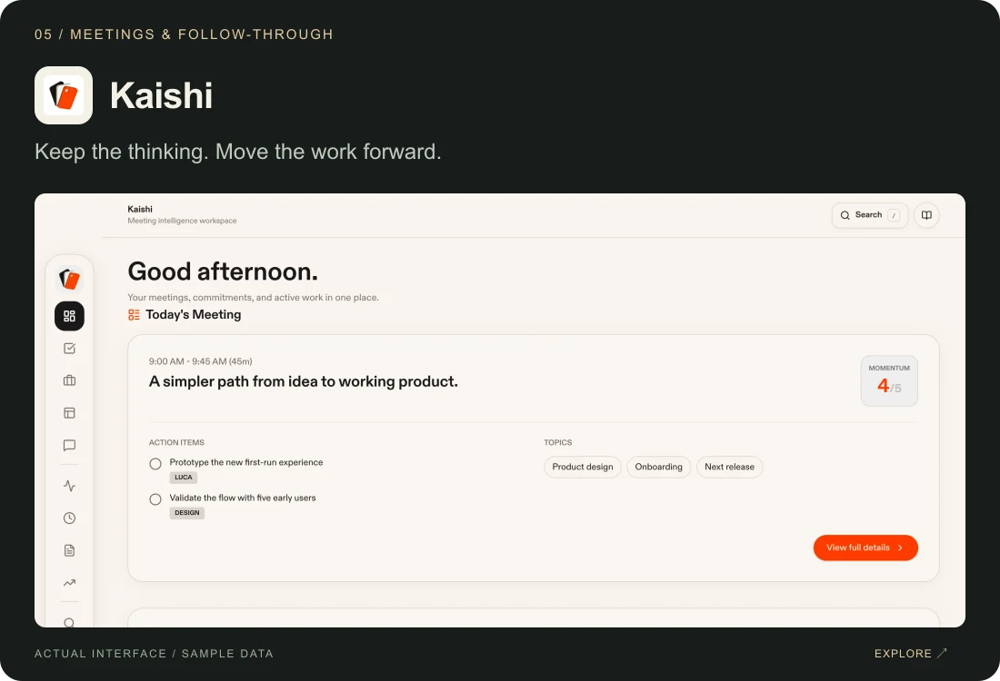
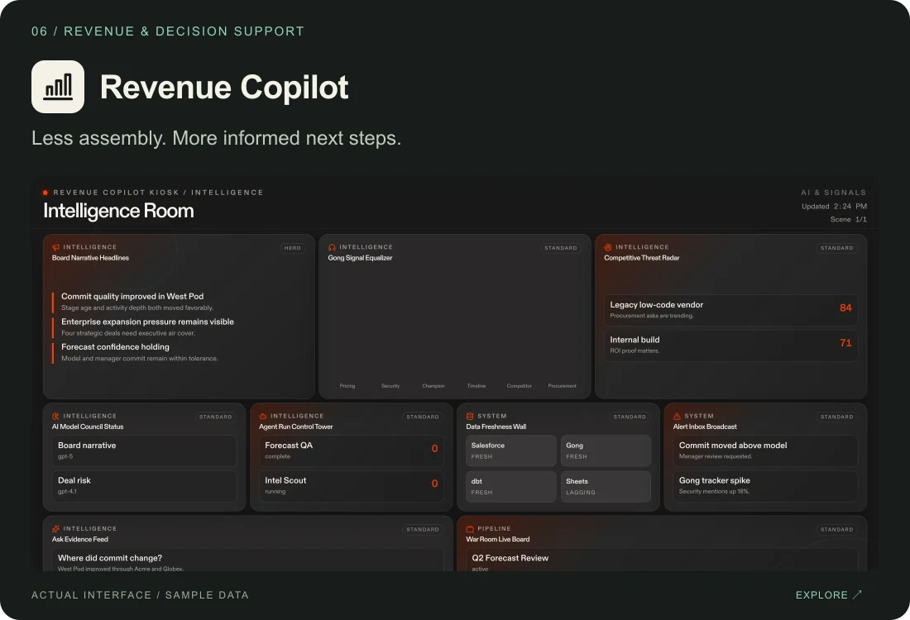
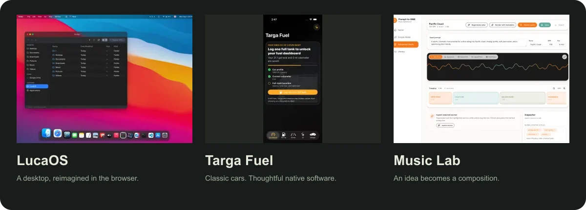
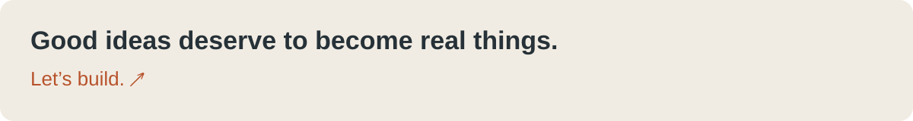

<!-- Generated by pnpm build. Edit data/profile.json and review/build-profile.mjs. -->
<picture><source media="(max-width: 600px)" srcset="assets/hero-mobile.svg"></picture>

<a href="https://luca.ooo"><b>Explore my portfolio ↗</b></a> &nbsp; · &nbsp; <a href="https://www.linkedin.com/in/luca-andrea/">LinkedIn</a> &nbsp; · &nbsp; <a href="https://x.com/agi2asi">X / @agi2asi</a> &nbsp; · &nbsp; <a href="mailto:ciao@luca.ooo">Say ciao</a>

### Ciao, I'm Luca.

I'm Luca, **AI Chief of Staff at [Replit](https://replit.com)**, based in San Francisco. I work where operations, AI, and product design meet: finding the friction, imagining a better experience, and building the tools to make it real.

I care about the whole thing: the person using it, the workflow behind it, the interface, and what happens after the first version ships.

## Built around the way people work

A selection of my work across the AI Studio portfolio. Different teams, different problems; one instinct to make the next step easier.

<table>
<tr><td width="50%" valign="top">  <a href="https://luca.ooo/#project-volare"><b>Volare ↗</b></a> Travel, approvals, hotels, and the unexpected — connected across web and native iOS.  </td><td width="50%" valign="top">  <a href="https://luca.ooo/#project-grid"><b>Grid ↗</b></a> A front door to company knowledge: people, resources, teams, and places.  </td></tr>
<tr><td width="50%" valign="top">  <a href="https://luca.ooo/#project-grep"><b>Grep ↗</b></a> Company search that keeps sources, context, and access attached to the answer.  </td><td width="50%" valign="top">  <a href="https://luca.ooo/#project-pulse"><b>PULSE ↗</b></a> Replit building and workspace intelligence, closer to hand in Chrome and Raycast.  </td></tr>
<tr><td width="50%" valign="top">  <a href="https://luca.ooo/#project-kaishi"><b>Kaishi ↗</b></a> Meeting capture, searchable context, and follow-through that survives the conversation.  </td><td width="50%" valign="top">  <a href="https://luca.ooo/#project-revenue"><b>Revenue Copilot ↗</b></a> Pipeline, forecasts, account research, and the context behind the next decision.  </td></tr>
</table>

Real product interfaces from my public portfolio, shown with sample or demo data. Explore each project for more context.

## The way I build

**Start with a person. Follow the workflow. Make something useful. Keep improving it.**

AI helps me move between an idea and a working product. Product judgment is deciding what deserves to exist, how it should feel, and what makes it worth coming back to.

<b>A few things I keep coming back to</b>

- **People first.** Understand the work before deciding where AI belongs.
- **Design the whole experience.** The interface, permissions, handoffs, and small details all count.
- **Keep the evidence.** Useful answers should come with sources and visible decisions.
- **Stay after the prototype.** Feedback, teaching, maintenance, and ownership are part of building.

Across the workbench: Replit · TypeScript · React · Python · SwiftUI · PostgreSQL · AI agents & MCP

## Curiosity doesn't clock out

Cars, music, native apps, connected devices, and a more personal web. The things that catch my attention tend to become things I build.

<a href="https://luca.ooo/#experiments"><picture><source media="(max-width: 600px)" srcset="assets/experiments-mobile.webp"></picture></a>

**[LucaOS](https://luca.ooo/#project-lucaos)** · **[Targa Fuel](https://luca.ooo/#project-targa)** · **[Music Lab](https://luca.ooo/#project-music)**

Also on my public workbench: my forks of **[Free Sleep](https://github.com/lucaandrea/free-sleep)** and the **[Muse Gadget SDK](https://github.com/lucaandrea/muse-gadget-sdk)**, exploring software that reaches into the physical world.

<a href="https://luca.ooo/work-with-me"><picture><source media="(max-width: 600px)" srcset="assets/footer-mobile.svg"></picture></a>

<a href="https://luca.ooo/work-with-me"><b>Advisory & working sessions ↗</b></a> &nbsp; · &nbsp; <a href="https://luca.ooo/insights/ai-chief-of-staff">Field notes</a> &nbsp; · &nbsp; <a href="https://agi2asi.ai">AGI2ASI</a>

